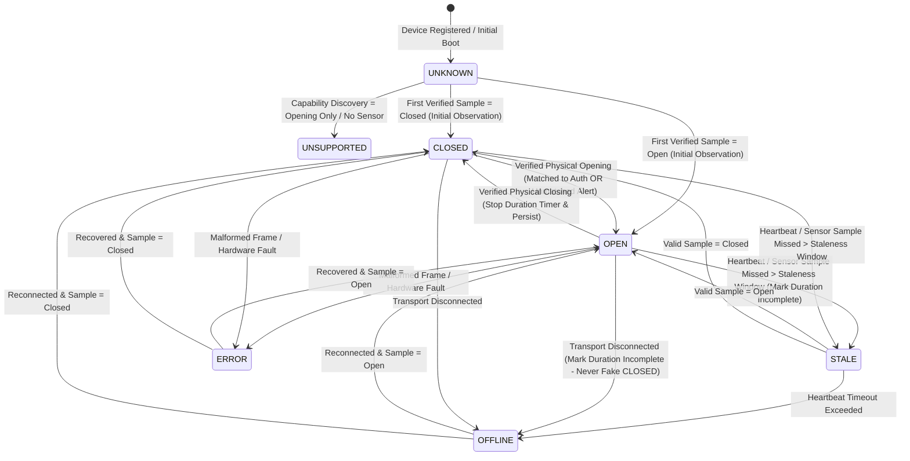

# PowerPOS — System Architecture, Communication Feasibility & Implementation Plan

**Document ID:** `PPOS-ARCH-001`  
**Version:** `1.0.0`  
**Target Odoo Compatibility:** Odoo 20.0 (`20.0.1.0.0`, OWL 2 POS Architecture, `pos.load.mixin`, Multi-Company, Multi-Branch)

---

## 1. High-Level System Architecture

```mermaid
flowchart TD
    subgraph Store_Edge["Store Edge / POS Register Layer"]
        WebPOS["Odoo Web POS (OWL Frontend)<br/>Hardware Status Widget & Controls"]
        AndroidPOS["Android POS / WebView Bridge<br/>Kotlin Hardware SDK (`com.powerpos.hardware.sunmi`)"]
        LocalBridge["PowerPOS Local Printer Bridge<br/>(Python Windows/Linux Service)"]
        SensorGW["ESP32 External Sensor Gateway<br/>(Reed Switch + Tamper Loop)"]
    end

    subgraph Physical_Hardware["Physical Hardware Layer"]
        SunmiBuiltin["SUNMI Built-in Printer & RJ11 Port<br/>(T2 / T2s / T3 / D2s / D3 Pro)"]
        SunmiCloudPrinter["SUNMI Cloud Printer<br/>(NT311 / NT212)"]
        EscPosPrinter["Standalone LAN / USB ESC/POS Printer<br/>(`DLE EOT 1` / `10 04 01`)"]
        CashDrawer["Physical Cash Drawer<br/>(Solenoid Pin 2/4 + Microswitch Pin 3)"]
    end

    subgraph Cloud_External["SUNMI Cloud Infrastructure"]
        SunmiOpenAPI["SUNMI OpenAPI (`https://openapi.sunmi.com`)<br/>HMAC-SHA256 Signed REST + Webhooks"]
    end

    subgraph Central_Odoo["Central Odoo Backend (Multi-Company / Multi-Store)"]
        CoreAddon["`powerpos_sunmi_core`<br/>Device Registry, Pairing & Capability Matrix"]
        CloudAddon["`powerpos_sunmi_cloud`<br/>OpenAPI Client, Print Queue & BIR Templates"]
        DrawerAddon["`powerpos_sunmi_cashdrawer`<br/>Drawer Registry, Auth Engine & State Machine"]
        AuditAddon["`powerpos_sunmi_audit`<br/>Immutable Hash-Chained Event Ledger"]
        MonitorAddon["`powerpos_sunmi_monitor`<br/>Rule Engine, Real-Time Bus & Alerts"]
        PosAddon["`powerpos_sunmi_pos`<br/>POS Session Loader & OWL Extensions"]
        ReportAddon["`powerpos_sunmi_reports`<br/>8 Operational & Audit Reports (PDF/CSV/XLSX)"]
    end

    WebPOS <-->|"JSON-RPC / Odoo Bus (WebSocket)"| PosAddon
    WebPOS <-->|"Restricted JS Bridge (if inside Android WebView)"| AndroidPOS
    AndroidPOS <-->|"Scoped Bearer + HMAC REST `/api/v1/*` + Room Offline Sync"| CoreAddon
    LocalBridge <-->|"Scoped Bearer + HMAC REST `/api/v1/*`"| CoreAddon
    SensorGW <-->|"Signed HTTPS `/api/v1/drawer/events`"| DrawerAddon

    AndroidPOS <-->|"Android AIDL (`woyou.aidlservice.jiuiv5`)"| SunmiBuiltin
    LocalBridge <-->|"Raw TCP 9100 / USB / Serial (`DLE EOT 1`)"| EscPosPrinter
    CloudAddon <-->|"HTTPS HMAC-SHA256 (`pushContent`, `printStatus`)"| SunmiOpenAPI
    SunmiOpenAPI <-->|"MQTT / TLS Cloud Spool"| SunmiCloudPrinter

    SunmiBuiltin -->|"RJ11 Pin 2/4 Kick & Pin 3 Sense"| CashDrawer
    EscPosPrinter -->|"RJ11 Pin 2/4 Kick & Pin 3 Sense"| CashDrawer
    SunmiCloudPrinter -->|"RJ11 Pin 2/4 Kick Only"| CashDrawer
    SensorGW <-->|"Dry-Contact Magnetic Reed Switch"| CashDrawer

    CoreAddon --> CloudAddon
    CoreAddon --> DrawerAddon
    DrawerAddon --> AuditAddon
    AuditAddon --> MonitorAddon
    AuditAddon --> ReportAddon
    MonitorAddon --> PosAddon
```

---

## 2. Communication Feasibility Report

### 2.1 Path A: SUNMI Android POS Built-in AIDL (`com.powerpos.hardware.sunmi`)
- **Transport:** Android Binder IPC (`woyou.aidlservice.jiuiv5.IWoyouService` / `com.sunmi.peripheral.printer.SunmiPrinterService`).
- **Latency:** `< 15 ms` for status query (`getDrawerStatus()`), `< 25 ms` for `openDrawer(callback)`.
- **Bidirectional Feasibility:** **Verified High** on desktop models with 6-pin RJ11 port and 5-wire cash drawer.
- **Offline Capability:** **100% Supported** via local SQLite (Room) queue with monotonic sequence numbers and background `WorkManager` / Coroutine sync client.

### 2.2 Path B: Local Printer Bridge (`local-bridge/python`)
- **Transport:** TCP Socket (Port 9100), PyUSB, or PySerial.
- **Status Protocol:** Sends `DLE EOT 1` (`0x10 0x04 0x01`) every configurable interval (`250ms` to `5000ms`, default `500ms` with 2-sample debounce and exponential backoff on error).
- **Bidirectional Feasibility:** **Supported** on ESC/POS printers that implement real-time status transmission (`DLE EOT 1`) and wire RJ11 Pin 3.
- **Safety Gate:** Validates response byte against `(byte & 0x93) == 0x12` before extracting Bit 2 (`0x04`). Any malformed byte or timeout transitions the driver health to `ERROR` or `OFFLINE` rather than guessing drawer state.

### 2.3 Path C: SUNMI Cloud Printer OpenAPI (`powerpos_sunmi_cloud`)
- **Transport:** Server-to-Server HTTPS (`https://openapi.sunmi.com`).
- **Authentication:** `Sunmi-Appid`, `Sunmi-Timestamp`, `Sunmi-Nonce`, `Sunmi-Sign` (`HMAC-SHA256(body + app_id + timestamp + nonce, app_key)`).
- **Bidirectional Feasibility for Drawer Status:** **Not Feasible Over Cloud Alone.** Cloud API only supports job submission (`pushContent`), job status (`printStatus`), and printer connectivity (`onlineStatus`).
- **Architectural Resolution:** When a store uses a Cloud Printer (e.g., NT311) and requires physical cash drawer monitoring, PowerPOS pairs the Cloud Printer (`powerpos.sunmi.device`) with either:
  1. A **Local Printer Bridge** monitoring local interface, OR
  2. An **External Sensor Gateway** (`sensor-gateway/`) bound to the same `powerpos.cashdrawer.device`.

---

## 3. Cash Drawer Physical State Machine



---

## 4. Module Dependency Graph (Odoo Addons)

```text
base, web, point_of_sale, mail
  └── powerpos_sunmi_core          (Device Registry, Pairing, Capabilities, Credentials Vault)
        ├── powerpos_sunmi_cloud   (SUNMI OpenAPI HMAC, Print Queue, BIR Receipt Builder)
        ├── powerpos_sunmi_cashdrawer (Drawer Registry, Auth Policy, State Machine, REST API)
        │     └── powerpos_sunmi_audit (Immutable Hash-Chained Event Log, Correlation Engine)
        │           ├── powerpos_sunmi_monitor (Alert Rules, Cron/Realtime Evaluators, Dashboard)
        │           │     └── powerpos_sunmi_pos (OWL POS Hardware Status Widget, Controls, Bus)
        │           └── powerpos_sunmi_reports (8 Operational & Exception Reports, PDF/CSV/XLSX)
```

